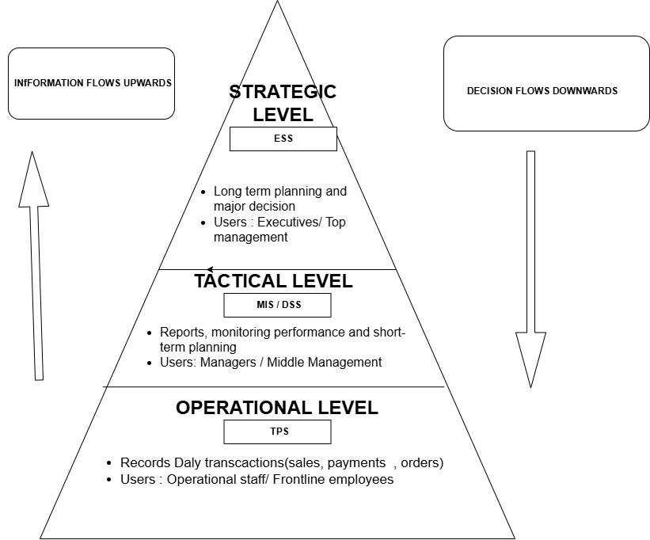

#Author: Nsuku Bright Shikhibana

Part 1

part 2

2.1 An IT Infrastructure Diagram shows the physical equipment used in an organisation, such as computers, servers, routers and cables. It shows how the equipment is connected.

2.2 An IT Landscape Diagram shows the different IT systems and applications used by an organisation, such as databases, websites and software. It gives an overview of the technology used in the business.

2.3 An IT Architecture Diagram shows how the different parts of an IT system are designed to work together. It includes the rules, standards and guidelines used to build the system.
